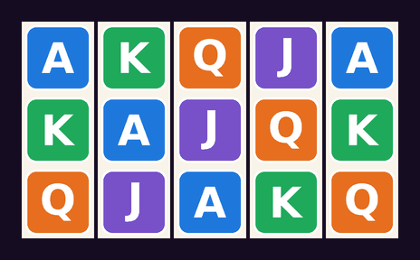
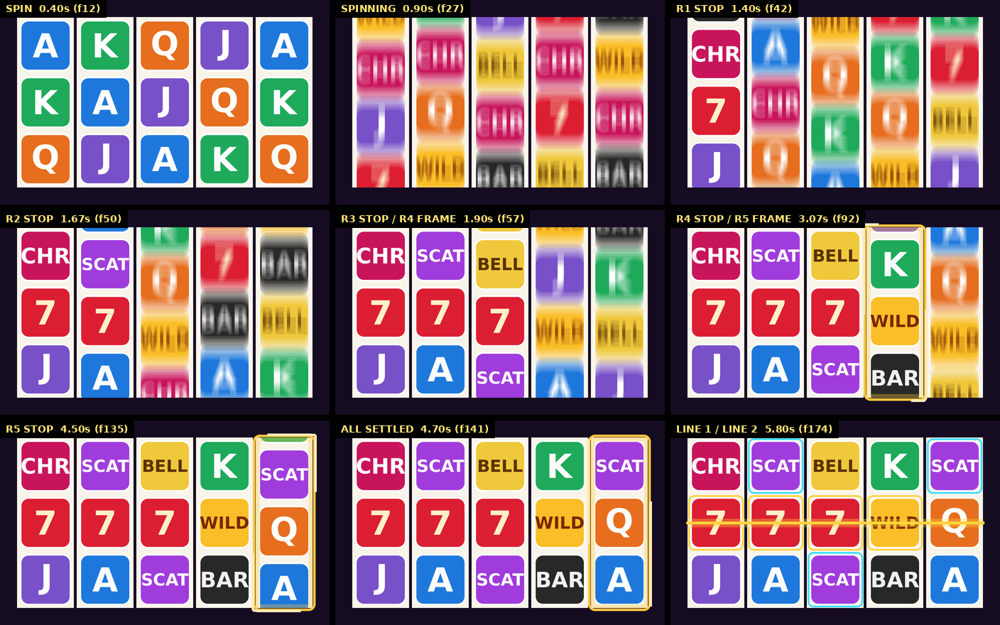

# SlotFakeSpin 老虎機假轉工具（After Effects）

匯入老虎機符號（圖騰）→ 指定 **起始盤面** 與 **結果盤面** → 設計停輪節奏、期待感、繞框、連線 → 一鍵在 AE 合成裡建好。

另外附一個懂期待感的 **Claude Code agent / skill**：開發人員丟符號圖和盤面圖，它會讀圖、設計節奏、出預覽，並直接驅動 AE 建好。



> 預覽圖由 `tools/sfs.js render` 產生：關鍵影格和 AE 用同一套 Bezier 計算，但這不是 AE 算圖。範例設定檔：[examples/freegame.json](examples/freegame.json)（3 顆 Scatter 觸發，第 4、5 輪期待）。

## 功能

**盤面**
- 符號庫：整個資料夾匯入（PNG / JPG / PSD / TGA / TIFF…，檔名 = 符號名），也可以用專案裡的素材或合成（動態符號）。
- 任意輪數 × 列數。點格子畫、Alt+點吸取、Shift+點整輪；也能用文字輸入，或直接從 Excel / Google 試算表貼上。
- 可以設定哪些符號不要在轉動中亂數出現（例如 Scatter / Bonus）。

**節奏**
- 停輪順序：左到右、右到左、從中間往外、同時停（`1+2+3,4,5`）；起轉也可以依序錯開。
- 每一步各自的轉速（`18,18,20,24,28`）、減速時間與曲線（**標準 / 緩停 / 急停**）、衝過頭回彈。
- **期待輪**：自動延長（一輪比一輪多）、繞框、繞框期間可以切到另一個轉速、改用緩停。
- **期待感建議**：依結果盤面和停輪順序模擬玩家看到的過程，自動判斷哪幾輪要期待（Scatter 差一顆、大獎聽牌），並附上理由。
- 「各輪」表格可以逐輪微調；「節奏」頁有時間軸圖，整段節奏一目了然。

**演出**
- **繞框**：內建跑燈框（圓角框 + 兩道跑燈 + 光暈），或換成你自己的素材；預設從「讓期待成立的那一輪停下」那一刻開始，停妥後結束。
- **連線**：內建 5×3 常見 20 線（可自訂線型表），從結果盤面自動偵測（百搭可代替），畫線動畫、中獎框、中獎符號跳動；可以「先全部亮、再逐條輪播」。
- **Scatter 框**：Scatter 不靠連線，數到觸發數就只框格子、不畫線。
- 盤面圖層上會打標記：`SFS SPIN`、`SFS R3 STOP / R4 FRAME`、`SFS ALL SETTLED`、`SFS LINE 1`…，直接拿來對音效。

**可回頭修改**：設定存在盤面合成裡。選取盤面圖層 →「讀取選取盤面」讀回面板；改完按「更新選取盤面」原地重建（圖層位置、上面加的特效都保留）。

## 安裝（AE 面板）

1. 下載 [`dist/SlotFakeSpin.jsx`](dist/SlotFakeSpin.jsx)。
2. 複製到 AE 的 ScriptUI Panels 資料夾：
   - Windows：`C:\Program Files\Adobe\Adobe After Effects <版本>\Support Files\Scripts\ScriptUI Panels\`
   - macOS：`/Applications/Adobe After Effects <版本>/Scripts/ScriptUI Panels/`
3. 重開 AE，從 **視窗 → SlotFakeSpin.jsx** 打開。

建議到 **偏好設定 → 指令碼與運算式**，勾選「允許指令碼寫入檔案及存取網路」（存 / 開設定檔、以及 agent 驅動 AE 時需要）。

### 介面語言（繁中 / English）

面板有繁體中文和英文兩種介面，預設「自動」：中文版 AE 用繁中；EffectCraft（Windows 介面字型沒有中文字，中文會變成方框）和其他語言的 AE 用英文。要固定語言，到「設定 → 介面語言」選「繁體中文」或「English」，面板會立刻重建，設定不會遺失，下次開啟也會沿用。

## 面板使用流程

| 分頁 | 做什麼 |
| --- | --- |
| 符號 | 「匯入資料夾…」；`●` 填充 / `○` 不當填充（雙擊切換）；「改名」取短名稱 |
| 盤面 | 切換起始 / 結果盤面，選畫筆點格子，或「文字編輯…」 |
| 節奏 | 「取目前時間」設定開始；停輪順序、轉速、減速；期待輪；「期待感建議」自動判斷 |
| 各輪 | 逐輪微調（可多選一起改、整體平移）。手動改過後，「節奏」頁的自動套用會關掉，避免被覆蓋 |
| 繞框 | 內建跑燈框的顏色、線寬、跑燈速度，或「指定選取」換成自己的素材 |
| 連線 | 「從結果盤面偵測」、新增 / 編輯線型與顯示時間（`0.3+1.2, 2.5+0.9` = 停妥後 0.3 秒顯示 1.2 秒…）、樣式 |
| 設定 | 介面語言；格子大小、間距、上下露出、留白、輸出到目前 / 新合成；起轉拉回、動態模糊等手感 |

最後按 **▶ 建立假轉**。

文字盤面格式：每一行是一列（由上到下），每行放輪數個符號；名稱有空白時用逗號或 Tab 分隔。

```
SEVEN SEVEN SEVEN BAR  BELL
WILD  WILD  WILD  A    K
Q     J     SCATTER A  A
```

## 和 agent 一起做（開發人員丟圖 → 自動建好）

在有 AE 的電腦上，於這個 repo 資料夾開 Claude Code（Claude Desktop，或終端機執行 `claude`），把 **符號圖檔資料夾** 和 **盤面截圖** 給它，說明要的效果，例如：

> 符號在 `D:\art\dragon\symbols`，結果盤面如圖，3 顆 Scatter 觸發 Free Game，要很有期待感，打在 `Main` 合成第 2 秒。

它會使用 [`slot-fake-spin` skill](.claude/skills/slot-fake-spin/SKILL.md)：

1. 建立設定檔、看符號總覽圖認符號。
2. 讀盤面截圖轉成文字盤面，產生盤面圖和原圖逐格比對，再跟你確認。
3. 依[期待感設計手冊](.claude/skills/slot-fake-spin/reference/anticipation.md)設計節奏（期待輪、繞框時機、連線演出）。
4. 自己檢查時間表和關鍵畫面，再把預覽給你看；你說「第 5 輪再久一點」它就改。
5. 直接驅動執行中的 AE 建好（或更新已經建好的盤面），用 AE 實際畫面再確認一次，最後交出音效對點表。

深入的節奏設計 / 審查可以交給 [`slot-anticipation-director`](.claude/agents/slot-anticipation-director.md) agent。

> 符號要是電腦上的檔案（給資料夾路徑）；盤面圖直接貼上就可以。

### 命令列（agent 用，也可以自己用）

```
node tools/sfs.js init --symbols examples/symbols --out work/demo/preset.json
node tools/sfs.js board work/demo/preset.json --end "CHERRY SCATTER BELL K SCATTER / SEVEN SEVEN SEVEN WILD Q / J A SCATTER BAR A"
node tools/sfs.js suggest work/demo/preset.json --apply
node tools/sfs.js lines work/demo/preset.json --detect
node tools/sfs.js check work/demo/preset.json
node tools/sfs.js render work/demo/preset.json --sheet work/demo/keys.png
node tools/sfs.js ae work/demo/preset.json --comp "Main"
```

`check` 會印出各輪時間表、文字時間軸和標記：

```
R1    =======~|..
R2    ==========|..
R3    ===========~|..
R4    ============*****~~~~|..*
R5    =====================*******~~~~~|.**
L1                                         111111111111111111
      = 轉動  * 繞框  ~ 減速  | 停輪  . 回彈  數字 = 連線顯示
```

完整指令：`node tools/sfs.js help`，說明在 [reference/cli.md](.claude/skills/slot-fake-spin/reference/cli.md)。
- 預覽（`render`、`symbols-sheet`）需要 Python 3 + Pillow：`pip install pillow`。
- `ae` 需要 AE 已開啟專案；找不到 AE 時設定環境變數 `SFS_AE`（Windows：`AfterFX.exe` 完整路徑；macOS：App 名稱，例如 `Adobe After Effects 2025`）。
- 也可以在 AE 用 **檔案 → 指令碼 → 執行指令碼檔案** 執行 [`dist/SlotFakeSpin_apply.jsx`](dist/SlotFakeSpin_apply.jsx)，選一個設定檔直接建立。

### 沒有 AE：用 EffectCraft 預覽

[EffectCraft](https://getartcraft.com/apps/effectcraft) 是開源的 AE 相容合成器，有命令列 `effectcraft-cli`。`ec` 指令用它在 `.ecproj` 專案裡建出跟 AE 一樣的盤面（同一份套用腳本，轉輪關鍵影格與 AE 一致），再算出檢查畫面和影片：

```
node tools/sfs.js ec work/spicy/preset.json --project work/spicy/MG.ecproj --comp MG --pos 540,1434 --render work/spicy/preview.mp4
```

- `--project` 不存在時會建立新專案（盤面放進新的 `SFS_Main_01` 合成）；存在時預設改寫原檔（原檔備份到執行資料夾的 `before.ecproj`），`--save-as` 另存新檔。
- `--mode auto|new|update`、`--board` 和 `ae` 相同；`--pos x,y` 指定盤面在目標合成的位置（預設放中央，更新時不動）。
- 回報實際的盤面合成名稱、標記，檢查畫面（`render-frame`）放在 `--out` 資料夾的 `frames/`；`--render` 依副檔名輸出 mp4 / mov / webm / gif，預設 0 秒到演出結束後 0.6 秒（`--range` 可改）。
- 符號圖（和自訂繞框 / 中獎格素材）要在專案資料夾內；不在時會列出檔案，加 `--copy-assets` 自動複製到 `<專案資料夾>/sfs_assets/`。
- 找不到 EffectCraft 時設定環境變數 `SFS_EC` 為 `effectcraft-cli` 的完整路徑（Windows 預設找 `%LOCALAPPDATA%\Programs\ArtCraft\effectcraft-*\effectcraft-cli.exe`）。

EffectCraft 0.3.1 跟 AE 的差異都已處理（見 [cli.md](.claude/skills/slot-fake-spin/reference/cli.md)「EffectCraft 已知限制」）；預覽以 EffectCraft 算圖為準，交付前仍建議在 AE 跑一次。



## 產生的內容

```
專案
└─ SlotFakeSpin/
   ├─ SFS_Symbols/          匯入的符號素材
   └─ SFS_Board_01/
      ├─ SFS_Board_01       盤面合成（放進你的合成；四周有留白給繞框 / 光暈）
      ├─ SFS_Board_01_R1…   各輪轉輪合成（合成大小 = 轉輪視窗，自動裁切）
      └─ …_null             轉帶控制 null 的固態層
```

盤面合成裡（由下到上）：`Reel 1…`、`Frame R4…`（繞框）、`Win R1-2_SEVEN…`（中獎符號跳動，放在盤面合成所以不會被裁切）、`Line 1…` / `Highlight 1…`（連線 / Scatter 框）。

每個轉輪合成內：

| 圖層 | 說明 |
| --- | --- |
| `STRIP_CTRL` | null，帶動整條轉帶；Y Position 上有全部的轉動關鍵影格（都對齊影格、速度連續） |
| `R1_S01_A`（綠色標籤） | 起始盤面第 1 列 |
| `R1_E01_WILD`（紅色標籤） | 結果盤面第 1 列 |
| `R1_F07_K` / `R1_B01_Q` | 轉動中經過的填充 / 緩衝符號（shy，時間軸預設隱藏） |

## 動作原理（給想改程式的人）

每一輪是一條轉帶，向下轉時由上到下排成 `[緩衝][結果盤面][填充 N 格][起始盤面][緩衝]`。一開始看到起始盤面，null 往下移 (列數 + N) 格後剛好看到結果盤面。

null 的 Y Position 是一串速度區段：起轉 → 反向拉回 → 加速 → 等速 →（繞框：變速 → 等速）→ 減速曲線 → 停輪（衝過頭）→ 回彈。先用設定的轉速算出要經過幾格（取整數 N），再把所有速度等比例微調，所以停輪位置分毫不差。加速 / 變速段用 33.33% 影響值 = 精準等加速度；減速曲線的 Bezier 控制點保證速度落在 0~v 之間（不倒退、不超速）。

## 開發

```
src/core.js      純邏輯：設定、盤面、節奏產生、期待感建議、連線、關鍵影格計算、介面語言 S.t（可在 Node 執行）
src/i18n_en.js   英文介面對照表（key = 原始碼的繁中字串）
src/ae.js        AE DOM：匯入、建立合成 / 圖層 / 形狀 / 關鍵影格 / 標記、讀回設定、輸出畫面
src/ui.js        ScriptUI 面板
src/main.js      面板進入點
src/apply.js     自動化進入點（讀設定檔建立，給 tools/sfs.js 用）
tools/build.js   建置 dist/（ES3 文法檢查、禁用 EffectCraft 沒有的 substr、移除註解、非 ASCII 轉 \uXXXX）
tools/sfs.js     命令列（agent 用）
tools/ec.js      EffectCraft 後端（sfs.js ec）
tools/render.py  預覽繪製（Pillow）
test/            模擬 AE（含形狀圖層、「新增屬性後舊參照失效」行為、EffectCraft 模式）、ScriptUI 與假 effectcraft-cli 的測試
.claude/         slot-fake-spin skill 與 slot-anticipation-director agent
```

```
npm install
npm test        # 建置 + 跑全部測試
npm run build   # 只建置 dist/
```

修改請改 `src/`，不要直接改 `dist/`。`dist/*.jsx` 全部是 ASCII，不受 Windows / macOS 語系編碼影響。

介面文字一律寫成 `T("繁中原文 {0}", 參數)`（不要用 `+` 拼句子，英文語序不同），並在 `src/i18n_en.js` 加上英文；同一個中文在不同地方意思不同時，用語境前綴 `T("count連")`。`npm test` 會檢查沒有漏翻、沒有多餘的 key、參數一致，以及原始碼裡沒有沒經過 `T()` 的中文字串。

測試會在模擬的 AE 物件模型裡跑完整流程，用和 AE 相同的 Bezier 內插算出每個時間點畫面上的符號，驗證「開始前 = 起始盤面、停妥後 = 結果盤面」、繞框 / 連線的時間與結構，並操作面板每個按鈕與命令列。**模擬環境不等於真的 AE，第一次使用請先在 AE 實際跑一次確認。**

## 已知限制

- 盤面格子縮圖只支援 PNG / JPG 符號；PSD、合成只顯示名稱。縮圖顯示異常可以在「盤面」取消勾選「縮圖」。
- 每一格是一個圖層，超大盤面或很長的轉動時間建立時會比較久。
- 不支援跨格的大符號（例如 2×2 巨型符號）。
- `ae` 輸出檢查畫面用的是 AE 未公開但長期存在的 `saveFrameToPng`；沒有的版本會略過畫面、照常建立。
- `ec`（EffectCraft）的限制見 [cli.md](.claude/skills/slot-fake-spin/reference/cli.md)「EffectCraft 已知限制」。
